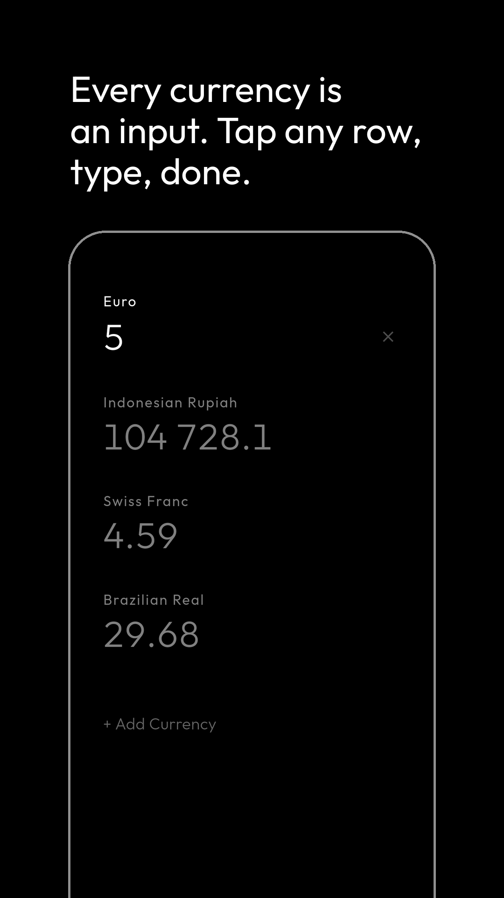
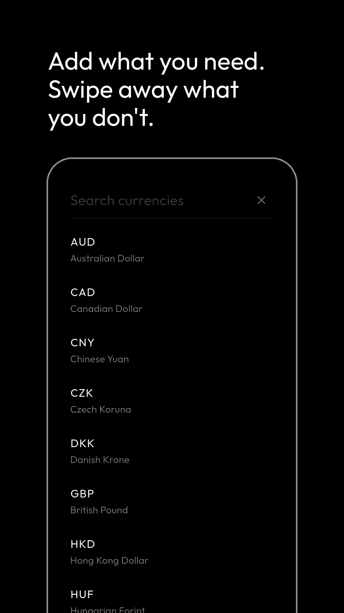
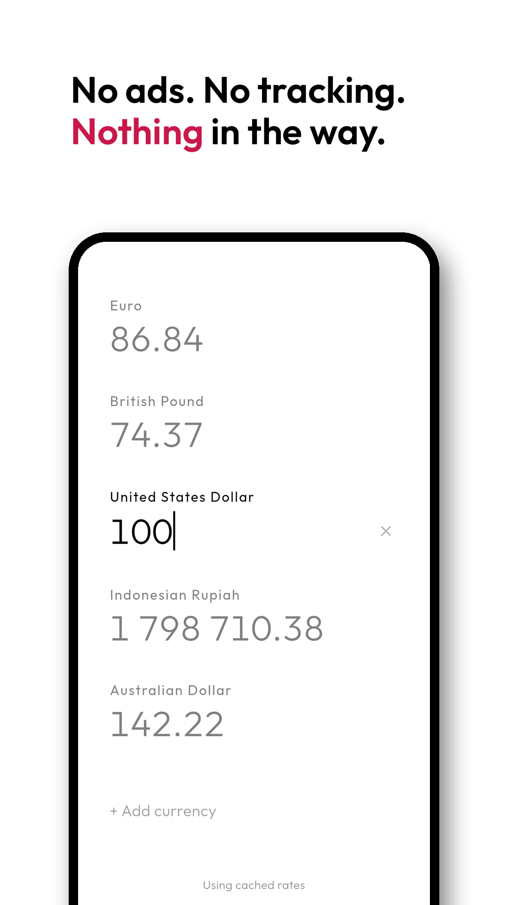

# Mars Currency

[](https://play.google.com/store/apps/details?id=com.catchingclouds.marsfx)

A currency converter where every row is both input and output. Tap a currency, type a number, and all the others update. There is no "from" and "to".

I built it because every converter I found was either ugly or bloated, usually both.

<p>
  
  
  
  
  
</p>

## What it does

- 60 currencies. Add one by searching its code or name.
- Rates refresh when you open the app and are cached, so it works offline.
- Swipe a row left to remove it, right to copy the amount. Hold a row to move it to the top.
- Black and white, dark or light.
- No ads, no tracking, no account.

Rates come from [ExchangeRate-API](https://www.exchangerate-api.com/)'s open endpoint, which needs no key.

## Build

You need the [Flutter SDK](https://docs.flutter.dev/get-started/install).

```bash
./install_debug.sh      # installs as "Mars Currency Debug"
./install_release.sh    # installs as "Mars Currency"
```

## Under the hood

Flutter and Dart, GetIt for DI, `ValueNotifier` for state, SharedPreferences for storage. See [CLAUDE.md](CLAUDE.md).

Part of [Mars](https://github.com/libaum/mars), a family of small, calm apps.

## License

MIT
